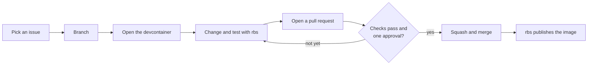

# How to contribute

Students and faculty build Redux together, and new contributors are welcome. Every Redux
repository works the same way:

1. You change the code inside the repository's **devcontainer**.
2. You check it with [**rbs**](rbs.md), the Redux Build System.
3. You open a **pull request**.
4. Someone reviews it, and it is merged once the checks pass.

This page walks through that loop once. The pages under **Repositories** cover what's different
in each project.

## The repositories

| Repository | What it is | Default branch | Devcontainer | The `build-test / ci` check |
| --- | --- | --- | --- | --- |
| [Redux](redux/index.md) | The API, C# on .NET 10 | `CSharpAPI` | yes | required |
| [Redux_GUI](redux-gui.md) | The website, Next.js | `ReduxAPI_GUI` | yes | required |
| [quantumsolver](quantumsolver.md) | The quantum service, Python | `main` | yes | required |
| [SPADE](spade.md) | The instance-parsing library, C# | `main` | yes | runs, but only reports |
| [mcpredux](mcpredux.md) | The MCP server, Python | `main` | yes | required |
| [Redux_VR](redux-vr.md) | The VR prototype, TypeScript | `main` | not yet | none yet |
| [Redux_Documentation](redux-documentation.md) | This site | `main` | yes | builds the site |

Each repository has exactly one long-lived branch, its **default branch**. Every pull request goes
into it. There is no `develop` branch.

## The loop



*Pick an issue, branch, open the devcontainer, change and test, then open a pull request. Repeat
the change-and-test step until the checks pass and someone approves. Then squash and merge, and
rbs publishes the result.*

## Pick an issue

Find something to work on in the repository's **Issues** tab, and leave a comment saying you're
taking it. If what you want to do has no issue yet, open one first and describe the change, so
nobody else starts the same work. A typo fix can skip this step.

## Get access

You push your branch to the ReduxISU organization, not to a fork of your own. That is what lets
rbs post its report on your pull request, because it can't comment on pull requests from forks.
To get permission to push, ask a maintainer on the [Redux Discord][redux-discord].

## Clone and make a branch

Clone the repository into a folder with **exactly the repository's name**, then branch from its
default branch. For example, for Redux:

```bash
git clone https://github.com/ReduxISU/Redux.git
cd Redux
git switch -c feat/936-job-cap origin/CSharpAPI
```

The devcontainer expects the folder name to match the repository's.

Name your branch `<type>/<issue>-<short-description>`:

| Type | For |
| --- | --- |
| `feat` | something new |
| `fix` | a bug fix |
| `docs` | documentation only |
| `test` | tests only |
| `chore` | upkeep such as dependency updates or reformatting |
| `ci` | the build and check setup |

For example: `feat/936-job-cap`, `fix/625-shor-failure-error`, `docs/12-fix-install-steps`.

## Open the devcontainer

A **devcontainer** is a ready-made development environment, described by the repository's
`.devcontainer/` folder. It has the right language version, the project's dependencies, and rbs,
so everyone builds and tests the same way, including the checks on GitHub.

=== "VS Code"

    1. Install [Docker](https://docs.docker.com/get-docker/) and the
       [Dev Containers](https://marketplace.visualstudio.com/items?itemName=ms-vscode-remote.remote-containers)
       extension.
    2. Open the repository folder in VS Code.
    3. Run **Dev Containers: Reopen in Container** from the Command Palette.

    The first build takes several minutes. Later starts are quick.

=== "Codespaces"

    On the repository's GitHub page, select **Code**, then **Codespaces**, then **Create codespace
    on** the default branch. Or, with the GitHub CLI:

    ```bash
    gh codespace create -R ReduxISU/Redux -b CSharpAPI
    ```

=== "Terminal"

    Install [Docker](https://docs.docker.com/get-docker/) and the devcontainer CLI, then start the
    container and open a shell in it:

    ```bash
    npm install -g @devcontainers/cli
    devcontainer up --workspace-folder .
    devcontainer exec --workspace-folder . bash
    ```

rbs is installed when the container is built. To pick up a newer rbs, rebuild the container. In
VS Code, run **Dev Containers: Rebuild Container**. From a terminal:

```bash
devcontainer up --workspace-folder . --remove-existing-container --build-no-cache
```

!!! tip "Two things that surprise people"

    - Each devcontainer publishes its service's port: 27000 for Redux, 3000 for the website. Only
      one container can use a port at a time, so stop the other one first.
    - Inside the devcontainer, `localhost` means the container itself, not your computer.

## Make the change and test it

Each repository's page gives the exact commands to run the project and its tests. Two rules apply
everywhere.

**Run what you depend on as a published image.** If the project you're changing needs another
one, run that one from its published image instead of cloning it. For example, the website needs
the API:

```bash
docker run -d --name redux-api -p 27000:27000 ghcr.io/reduxisu/redux:latest
```

!!! warning "Never point your work at the live site"

    Don't send your tests, tools, or experiments to [redux.isu.edu][redux-site]. Students are
    using it, it can run older code than the default branch, and one heavy request can tie up the
    server. Some projects use the live site by default. Their pages show how to point them at a
    local copy instead.

**Run the checks before you push.** rbs runs the same steps on your computer as it does on GitHub:

```bash
rbs ci
```

That runs every step and writes the results to `report.md`. To run one step, name it, for example
`rbs lint` or `rbs unit-test`. [The build system (rbs)](rbs.md) explains every step.

## Commit

Write each commit message as a plain sentence saying what the change does, such as *Cap the
compute jobs running at once*. Commit as often as you like. When the pull request is merged, its
commits are squashed into one.

Keep each pull request to one change. If a change needs code reformatted, reformat in a separate
pull request first, so the real change is easy to review.

## Open a pull request

Push your branch:

```bash
git push -u origin feat/936-job-cap
```

GitHub then offers **Compare & pull request**. Check that the base is the default branch, then
fill in:

- **The title:** a plain sentence saying what the change does. It becomes the commit message when
  the pull request is squashed.
- **The description:**
    - what you changed and why;
    - `Closes #936` (with your issue number), so the issue closes when this merges;
    - how you tested it: the commands you ran, and screenshots for anything visual.

Open it as a **draft** if you want early feedback before it's finished.

## Pass the checks

The **`build-test / ci`** check runs rbs on GitHub, inside the same devcontainer you used. It
takes several minutes, because the container is rebuilt for every run. When it finishes, it posts
a comment titled **Redux Build System — CI Report**, with one row per step and an overall result.

If a step fails, read its row and the details under it. Then reproduce the failure on your
computer with the same rbs step, fix it, and push again. The check runs again, and the same comment
is updated. [When the check is red](rbs.md#when-the-check-is-red) lists the usual causes.

Other checks, such as code scanning, may also run. Only `build-test / ci` must pass.

## Get a review

Every pull request needs **one approving review**. Ask for one on Discord, or request a reviewer on
the pull request. Answer review comments by pushing more commits. An approval stays in place
when you push again, but if you change a lot after it, ask the reviewer to look again.

## Merge

Once the pull request has an approval and the check is green, **you or the reviewer can merge
it**. GitHub won't allow the merge before then.

1. Choose **Squash and merge**.
2. Select **Delete branch** afterwards. Branches aren't deleted automatically.

## After the merge

For the projects that publish an image (Redux, Redux_GUI, quantumsolver, and mcpredux), rbs builds
it, tests it, and publishes it to `ghcr.io/reduxisu/<project>`, tagged with the commit and as
`latest`. The live site picks up the new image when the maintainers next update it, which they
do by hand.

## Ground rules

- **License:** your contribution is released under the repository's license.
- **No secrets:** never commit passwords, tokens, or `.env` files.
- **Ask early:** a question on Discord costs less than a pull request headed the wrong way.
