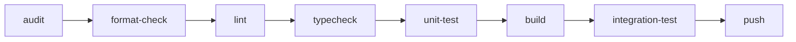

# The build system (rbs)

**rbs**, the Redux Build System, checks, builds, tests, and publishes every Redux project. It is
a command-line program. GitHub doesn't hold the build steps; it installs rbs and runs it. The
same program runs on your computer, inside a devcontainer, and on GitHub, so "it passed for me"
and "it passed on my pull request" mean the same thing.

!!! info "Verified against `Redux_Build_System@ad44b42` on 2026-11-07"

    rbs lives in the [Redux_Build_System][repo-rbs] repository. A change merged there reaches
    every project on its next run.

## Why it works this way

- **One program instead of a workflow file per project.** The steps live in Python code, in one
  place. Every project runs the same steps, adapted to its language.
- **The image that was tested is the image that ships.** rbs builds the project's container image
  once, runs the integration tests against that image, and publishes that same image. Nothing is
  rebuilt between testing and publishing.
- **One check to require.** Branch protection asks for a single check, `build-test / ci`. Adding
  steps to rbs never makes that check go stale.

## How a run works

`rbs ci` runs eight steps, always in this order:



*audit, then format-check, lint, typecheck, unit-test, build, integration-test, and push.*

Each step ends with one of five results:

| Result | Means |
| --- | --- |
| ✅ success | The step passed. |
| ❌ failure | The step failed. The whole run fails. |
| ⏭️ skipped | The step doesn't apply here. For example, there's no `tsconfig.json` to type-check, or `push` outside GitHub. |
| ⚠️ warning | The step passed with a caveat, such as a dry-run push. It doesn't fail the run. |
| ⛔ blocked | The step didn't run because a step it needs failed. |

Two steps wait on others. `integration-test` needs `build`. `push` needs every step before it,
so an image is published only when everything else passed. `rbs ci` never stops early: it runs
every step it can, so you see all the problems at once.

## Run it yourself

Inside a project's devcontainer, `rbs` is already installed:

```bash
rbs ci             # every step, then the report
rbs lint           # one step
rbs report         # rebuild report.md from the steps already run
```

Outside a devcontainer you can run it with [uv](https://docs.astral.sh/uv/). You also need the
project's own tools, such as .NET or Node, and Docker:

```bash
uvx --from git+https://github.com/ReduxISU/Redux_Build_System rbs ci
```

Each step saves its result in `.rbs/report/`, and the report is written to `report.md`. Git
ignores both.

| Option | On | Does |
| --- | --- | --- |
| `--variant <name>` | any step, `ci` | Runs one variant, such as one Python version: `rbs unit-test --variant 3.13`. |
| `--dry-run` | `push`, `ci` | Logs in and tags the image but doesn't publish it. |
| `--soft` | `report`, `ci` | Reports failures without failing. |
| `--post` | `report`, `ci` | Posts the report as a pull-request comment. GitHub uses this. |

## Read the report

This is the report from a real run of the website, Redux_GUI, at commit `a056f6c`:

| Operation | Status | Summary | Time |
|---|:--:|---|--:|
| audit | ✅ | no known vulnerabilities | 0.6s |
| format-check | ✅ | 1 advisories | 0.4s |
| lint | ✅ | 34 warnings | 8.1s |
| typecheck | ⏭️ | no tsconfig.json | — |
| unit-test | ✅ | 25 passed | 0.3s |
| build | ✅ | built `local/redux_gui:ci` · 341MB | 100.1s |
| integration-test | ✅ | /api/health ready · 19 passed | 20.8s |
| push | ✅ | pushed `ghcr.io/reduxisu/redux_gui:a056f6c`, `:latest` | 4.4s |

**Overall: ✅ 7 passed · 0 failed · 1 skipped**

Below the table, a collapsible section for each step lists its findings, such as each lint warning
with its file, line, and rule.

On a pull request, rbs posts this as one comment titled **Redux Build System — CI Report**, and
updates it each time the check runs again. It also appears in the run's summary on GitHub, and you
can download it as the `rbs-report` artifact.

## The steps

| Step | Checks | Needs |
| --- | --- | --- |
| `audit` | The project's dependencies for known security vulnerabilities | |
| `format-check` | That the code is formatted the project's way. It changes nothing. | |
| `lint` | Code problems a tool can spot without running it | |
| `typecheck` | Types, where the language has a separate type checker | |
| `unit-test` | The unit tests, and a minimum test coverage where one is set | |
| `build` | That the container image builds | |
| `integration-test` | The built image, running, against its integration tests | `build` |
| `push` | Publishes the tested image | every step before it |

## The engines

Each project names its **engine** in `rbs.toml`, the toolchain rbs uses for the first five
steps. The container steps, `build`, `integration-test`, and `push`, work the same in every
engine.

| Step | `uv` (Python) | `npm` (JavaScript) | `dotnet` (C#) |
| --- | --- | --- | --- |
| `audit` | `pip-audit` on the locked dependencies | `npm audit --omit=dev` | `dotnet list package --vulnerable`. Any finding fails. |
| `format-check` | `black --check` | `biome check` | `dotnet format --verify-no-changes` |
| `lint` | `ruff check` | `eslint` | `dotnet build -c Release`, where warnings count as errors |
| `typecheck` | skipped | `tsc --noEmit`, skipped with no `tsconfig.json` | skipped, because the build already checks types |
| `unit-test` | `pytest`, once per Python version listed | `npm test`, skipped with no `test` script | `dotnet test` with coverage |
| coverage minimum | enforced when `package` is set | not enforced | enforced |

| Engine | Used by |
| --- | --- |
| `uv` | quantumsolver, mcpredux, and rbs itself |
| `npm` | Redux_GUI |
| `dotnet` | Redux, SPADE |

## Build and test the image

**`build`** builds the image from the project's `Dockerfile` and tags it `local/<name>:ci`. It
never leaves your machine at this stage. A project without a `Dockerfile` (a library such as
SPADE) skips it.

A project can run a command before the build with `[build] pre-command`. Redux uses this to fill
in contributor counts. It runs only on GitHub, unless `pre-command-local = true`. If
`pre-command-optional = true`, a failing command gives a ⚠️ warning instead of failing the
build.

**`integration-test`** stands up a small, throwaway stack and tests it:

1. It starts each service the project depends on, listed in `[[integration.services]]`.
2. It starts the image it just built.
3. It waits for each one's `health-path` to answer, by default up to 180 seconds each.
4. It runs the project's integration command, giving it the image's address in `RBS_BASE_URL`.
5. It always removes the stack afterwards.

The website, for example, tests its image against the published API image:

```toml
[integration]
command = "npm run test:e2e"
timeout = 240

[[integration.services]]
name = "redux-api"
image = "ghcr.io/reduxisu/redux:latest"
port = 27000
health-path = "/Navigation/Batch/allProblems"

[integration.env]
REDUX_BASE_URL = "http://redux-api:27000/"
```

## Publish the image

**`push`** publishes the tested image to the GitHub Container Registry. It runs only when all
of these hold:

- the run is on GitHub, not on your computer;
- it is a push to the branch named in `[push] on-branch`, which is the default branch, not a pull
  request;
- no step before it failed.

It tags the image twice, first with the short commit hash (`:a056f6c`) and then `:latest`, so
every published build can be found again. Everywhere else, `push` reports ⏭️ skipped with the
reason. `rbs push --dry-run` logs in and tags the image without publishing it.

## Configuration: `rbs.toml`

Each project keeps an `rbs.toml` at its root. This is quantumsolver's:

```toml
engine = "uv"
package = "quantumsolver"

[unit-test]
python-versions = ["3.12", "3.13"]
coverage-min = 85

[artifact]
image = "ghcr.io/reduxisu/quantumsolver"
port = 27100
health-path = "/health"

[integration]
command = "uv run pytest integration -v"

[push]
on-branch = "main"
```

!!! warning "rbs ignores keys it doesn't know"

    A misspelled key is silently ignored, and its default is used instead. If a setting seems to
    have no effect, check its spelling against the table below.

| Key | Default | Does |
| --- | --- | --- |
| `engine` | required | `uv`, `npm`, or `dotnet` |
| `package` | none | Python: the package to measure coverage for. Also a fallback image name. |
| `solution` | the first `.slnx` or `.sln` | .NET: the solution to build and test |
| `[unit-test] coverage-min` | 0 | The lowest test coverage allowed, in percent |
| `[unit-test] python-versions` | none | Python: run the tests once per version. Quote them: `"3.12"`. |
| `[artifact] image` | none | Where the image is published, such as `ghcr.io/reduxisu/redux` |
| `[artifact] name` | from `image` | The local image name |
| `[artifact] dockerfile` | `Dockerfile` | The Dockerfile to build. With none, `build` is skipped. |
| `[artifact] context` | `.` | The folder to build from |
| `[artifact] port` | 0 | The port the image listens on |
| `[artifact] health-path` | `/` | The address that answers when the image is ready |
| `[build] pre-command` | none | A command to run before the build |
| `[build] pre-command-local` | false | Also run it outside GitHub |
| `[build] pre-command-optional` | false | Treat its failure as a warning |
| `[integration] command` | none | The integration-test command. With none, the step is skipped. |
| `[integration] timeout` | 180 | Seconds to wait for each container to be ready |
| `[integration.env]` | none | Environment variables for the image under test |
| `[[integration.services]]` | none | Containers to start first: `name`, `image`, `port`, `health-path`, `env` |
| `[push] on-branch` | none | The branch to publish from. Together with `image`, it turns `push` on. |

## On GitHub

Every project has the same short workflow, `.github/workflows/rbs.yml`. It hands the run to the
shared workflow in Redux_Build_System:

```yaml
name: rbs

on:
  pull_request:
  push:
    branches: [main]

permissions:
  contents: read
  pull-requests: write
  packages: write

concurrency:
  group: rbs-${{ github.ref }}
  cancel-in-progress: true

jobs:
  build-test:
    uses: ReduxISU/Redux_Build_System/.github/workflows/ci.yml@main
    secrets: inherit
```

The shared workflow builds the project's own devcontainer and runs `rbs ci --post` inside it. The
check therefore uses the same tools you do, and the container is rebuilt on every run, which takes
several minutes.

!!! warning "Don't rename the jobs"

    The check is named after the job in `rbs.yml` (`build-test`) and the job in the shared workflow
    (`ci`). Branch protection requires a check with exactly the name `build-test / ci`. Renaming
    either job leaves that check unsatisfiable, and every pull request is blocked.

Only a fixed list of GitHub variables reaches rbs inside the container. A new secret needs a change
to the shared workflow. A project can pass `soft: true` to report without failing, which SPADE
does for now, or `dry-run: true` to rehearse publishing.

## When the check is red

Find the ❌ row in the report, open its details, and then run that step on your computer.

| Step | Usual cause | What to do |
| --- | --- | --- |
| `audit` | A dependency has a known vulnerability | Update the package the details name, then commit the updated lock file. |
| `format-check` | Some code isn't formatted the project's way | Run the formatter: `uv run black .` (Python), `npm run format` (website), `dotnet format <solution>` (.NET). |
| `lint` | The linter found a problem | Python: `uv run ruff check --fix .` and fix the rest by hand. Website: `npm run lint:fix`. .NET: fix the compiler warning, since warnings count as errors. |
| `unit-test` | A test fails, or coverage is under the minimum | Run the tests locally. For coverage, add tests for the code you changed. |
| `build` | The image doesn't build, or a required pre-command failed | Run `rbs build` locally and read the output. |
| `integration-test` | A container didn't start, or a test failed | Read the log lines in the details. A container that "failed to start" or is "not ready" usually crashed at startup, or is listening on a different port or health path. |
| `push` | ⛔ blocked | An earlier step failed. Fix that one first. |

!!! note "Pull requests from forks get no report comment"

    rbs can't post its comment on a pull request from a fork. The check still runs and still
    passes or fails. This is one reason to push your branch to ReduxISU instead.

## Change rbs itself

rbs is built in the [Redux_Build_System][repo-rbs] repository. Its devcontainer installs rbs from
the working copy, so your edits take effect immediately.

```bash
uv sync --all-groups
uv run pytest
uv run rbs ci
```

The repository has no check of its own on GitHub, so run its tests and `rbs ci` yourself before
opening a pull request.

Every project uses the shared workflow from `main`, and the devcontainer feature installs rbs from
`main`. **A change merged to `main` reaches every project on its next run.** Try a change against
a real project before merging it. `rbs_dev.sh` runs your working copy against another
repository, either directly or inside that repository's devcontainer:

```bash
cd ../quantumsolver
../Redux_Build_System/rbs_dev.sh lint        # your rbs, on this machine
../Redux_Build_System/rbs_dev.sh -c shell    # your rbs, inside quantumsolver's devcontainer
```

The **devcontainer feature** is what installs rbs into each project's devcontainer. It lives in
`features/src/rbs/`. If you change it, raise the `version` in `devcontainer-feature.json`, or the
change is never published.
