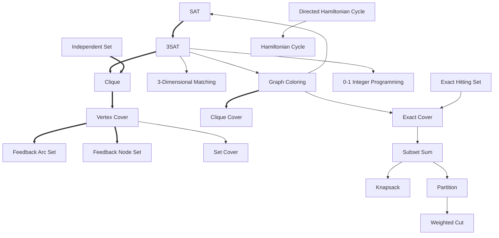

# Reductions

What is a reduction, and how does turning one problem into another prove that a problem is hard?

--8<-- "includes/faculty-review.md"

## The short version

A **reduction** from problem A to problem B is a fast recipe that turns any instance of A into an
instance of B with the same yes-or-no answer. If such a recipe exists, B is at least as hard as
A, because anything that solves B also solves A. To show a new problem is NP-complete, reduce a
known NP-complete problem *to* it.

## Answering one question by asking another

Say you want to know whether some of the coins in your pocket add up to exactly 28 cents. That
is [Subset Sum](problems-and-instances.md). A friend can only answer a different question: can
this pile be split into two halves of equal value? That is Partition.

You can still get your answer. Add two extra coins of the right values to the pile, ask your
friend, and read their answer as yours. For the coins 1, 7, 12, and 15 and the target 28, Redux
adds a 29 and an 8. The pile now totals 72, and it splits into two halves of 36 exactly when
some of the original coins make 28: 1 + 12 + 15 + 8 on one side, 7 + 29 on the other.

You never solved your own problem. You rewrote it as one your friend can solve. That rewriting is
a reduction.

## What a reduction must do

A reduction from A to B, written A ≤ₚ B, must:

1. **Run in polynomial time.** Rewriting the instance can't secretly do all the hard work.
2. **Keep the answer, both ways.** A "yes" instance of A must become a "yes" instance of B, and
   a "no" instance must become a "no" instance.

Redux tags each reduction with how fast its output grows compared with its input: Linear,
Quadratic, Cubic, or HigherPolynomial. All of them are polynomial.

## Which way the arrow points

This is the part people most often get backwards.

If A reduces to B, then a fast algorithm for B gives a fast algorithm for A: rewrite, then ask
B. So **B is at least as hard as A**.

To prove a *new* problem B is hard, reduce a problem you *already know* is hard to B. Reducing B
to a hard problem proves nothing about B. Almost anything can be turned into a hard problem.

This is how [NP-completeness](complexity-classes.md#np-hard-and-np-complete-the-hardest-ones)
spreads. Cook showed SAT is NP-complete. Then SAT reduces to 3SAT, 3SAT reduces to Clique, Clique
reduces to Vertex Cover, and each problem along the chain inherits the hardness.

## A worked example: 3SAT to Clique

This construction, from Michael Sipser's textbook, turns a 3SAT formula into a graph. Take a
formula with two clauses:

```text
(x1 | x2 | !x3) & (!x1 | x2 | x3)
```

1. **Make one node for each literal in each clause.** Redux names them `x1_0`, `x2_0`, and so
   on, where `_0` means clause 0.
2. **Connect two nodes when they are in different clauses and don't contradict each other.** `x1`
   and `!x1` contradict, so they get no edge. Neither do `!x3` and `x3`.
3. **Ask for a clique the size of the number of clauses.** Here *k* = 2.

--8<-- "includes/diagrams/sat3-to-clique.svg"

*Clause 0's three nodes are on the left and clause 1's on the right. Every pair across the two
clauses is joined except `x1_0`–`!x1_1` and `!x3_0`–`x3_1`, which contradict, giving seven edges.
The thick edge is a clique of size 2.*

**Why it works.** A clique of size *k* must use one node from each clause, because nodes in the
same clause are never joined. Its nodes never contradict, because contradicting nodes are never
joined. So set each chosen literal to true. Every clause then has a true literal, and the formula
is satisfied. The reverse also holds: from a satisfying assignment, pick one true literal per
clause, and those nodes form a clique of size *k*.

You can run this exact example in Redux:

| Step | Input | Redux's answer |
| --- | --- | --- |
| Reduce the formula | the formula above | the graph above, with *k* = 2 |
| Map an answer forward | `(x1:True,x2:True,x3:True)` | the clique `{x1_0,x2_1}` |
| Map an answer back | the clique `{x2_0,x2_1}` | `(x1:False,x2:True,x3:False)` |

Mapping back from `{x2_0,x2_1}`, Redux explains each step: *"Node x2_0 is in the clique, so x2 =
True"*, then *"No clique node mentions x1, so it can be anything"*.

## Gadgets

A **gadget** is a piece of a reduction's output built to stand for a piece of its input. Above,
each clause became a group of three nodes, a *clause gadget*, and each literal became one node.

Redux records these correspondences, so a picture can show which part became which:

- **Element** gadgets link one input piece to one output piece, such as the literal in clause 0,
  position 0, to the node `x1_0`.
- **Group** gadgets link a whole clause to its group of nodes.

Redux has more kinds for other constructions, such as rules about which edges exist. Not every
reduction records its gadgets yet.

## Mapping answers

A reduction transforms instances, but students usually also want to move *answers* across it.

- **Forward:** from an answer for A to the matching answer for B. A reduction's proof of
  correctness says how to do it.
- **Back:** from an answer for B to an answer for A. This is what you need in practice: solve the
  B instance, then translate the answer back. Only some of Redux's reductions can do this today.

## Chains of reductions

Reductions compose. If A ≤ₚ B and B ≤ₚ C, then A ≤ₚ C: rewrite twice. Karp's 1972 paper is a
tree of such chains, all starting from SAT.

Redux can find chains for you. When you pick a target problem with no direct reduction, the
website offers the chain of reductions that gets there. For 3SAT to Vertex Cover it offers
*Sipser's Clique Reduction - Sipser's Vertex Cover Reduction*. The API can also return the
[cheapest chain](../reference/api.md#discovery), weighted by each reduction's declared cost.

## The reductions in Redux

As of 2026-11-06, Redux has 19 reductions connecting 20 problems. A thick arrow means the
reduction records its gadgets.



*The same reductions as a table:*

| From | To | Reduction | Gadgets | Maps back |
| --- | --- | --- | :---: | :---: |
| SAT | 3SAT | Karp's 3SAT Reduction | ✓ | |
| 3SAT | Clique | Sipser's Clique Reduction | ✓ | ✓ |
| 3SAT | 3-Dimensional Matching | Garey-Johnson Reduction | | |
| 3SAT | Graph Coloring | Karp's Graph Coloring Reduction | | |
| 3SAT | 0-1 Integer Programming | Karp's 0-1 Integer Linear Programming Reduction | | |
| Independent Set | Clique | Clique Reduction | ✓ | ✓ |
| Clique | Vertex Cover | Sipser's Vertex Cover Reduction | ✓ | ✓ |
| Vertex Cover | Feedback Arc Set | Lawler-Karp Arc Set Reduction | ✓ | |
| Vertex Cover | Feedback Node Set | Karp's Node Set Reduction | ✓ | |
| Vertex Cover | Set Cover | Karp's Set Cover Reduction | | |
| Graph Coloring | Clique Cover | Clique Cover Reduction | ✓ | |
| Graph Coloring | Exact Cover | Karp's Exact Cover Reduction | | |
| Graph Coloring | SAT | Karp's SAT Reduction | | |
| Exact Hitting Set | Exact Cover | Exact Cover Reduction | | |
| Exact Cover | Subset Sum | Karp's Subset Sum Reduction | | |
| Subset Sum | Knapsack | Feng's Knapsack Reduction | | |
| Subset Sum | Partition | Partition Reduction | | |
| Partition | Weighted Cut | Weighted Cut Reduction | | |
| Directed Hamiltonian Cycle | Hamiltonian Cycle | Karp's Hamiltonian Reduction | | |

For the current list, use the website's **Browse** page and its **Reachable from** filter, or
call [`/Navigation/Reductions`](../reference/api.md#discovery).

## Common misconceptions

- **"Reduce the new problem to a hard one."** Backwards. Reduce a *known* hard problem to the new
  one.
- **"A reduction solves the problem."** It only translates. Someone still has to solve the
  translated instance.
- **"A reduction only has to turn yes into yes."** It must turn no into no as well. Otherwise
  B's answer tells you nothing about A.
- **"Gadgets are part of the definition."** The definition only asks for a correct, fast
  translation. Gadgets are how people design one and explain it.

## How Redux shows it

On [redux.isu.edu][redux-site]:

1. Pick **3SAT** in the **Problem** row.
2. In the **Reduce** row, choose **Clique** as the problem to reduce to, then choose the
   reduction. Redux runs it as soon as you choose, and shows the new instance.
3. In the **Visualize** row, turn on **Show reduction** to see both problems side by side, and
   **Highlight gadgets** to see which parts correspond.

## Further reading

- R. M. Karp, "[Reducibility among combinatorial problems](https://doi.org/10.1007/978-1-4684-2001-2_9)",
  1972, and the list of [Karp's 21 NP-complete problems](https://en.wikipedia.org/wiki/Karp%27s_21_NP-complete_problems).
- M. Sipser, *Introduction to the Theory of Computation*, section 7.4, which includes the 3SAT to
  Clique reduction.
- M. R. Garey and D. S. Johnson, *Computers and Intractability* (1979), chapter 3.
- [Polynomial-time reduction](https://en.wikipedia.org/wiki/Polynomial-time_reduction) on Wikipedia.
